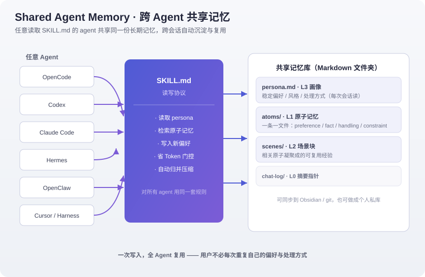
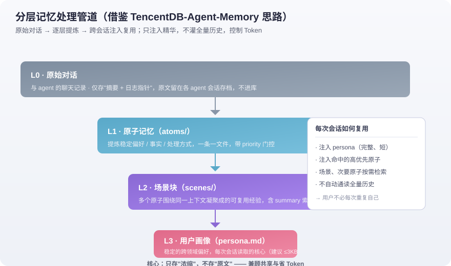

<div align="center">

# 🧠 Shared Agent Memory Skill

**让任意 agent 共享同一份长期记忆 —— 跨会话、跨 agent 自动沉淀与复用**

一个**通用、去平台化**的 Agent 记忆库 Skill。无论你用 Codex、Claude Code、Hermes、OpenClaw、
OpenCode、Cursor 还是各类 Harness，只要它读取标准 `SKILL.md`，就能加载并共享这份记忆。

**"每个 agent 都记住你是谁、你怎么做事，你不用每次重说一遍。"**

</div>

---

## 🎯 它解决什么问题

👋 你有没有这样的经历——**每次用一个 Agent，都要重新交代一遍你是谁、你的项目背景、你偏好怎么做事？**

- 同一个需求，在 Codex 里说过，到 Claude Code 又要再说一遍。
- 上周跑通的流程，这周换个会话就"忘了"，只能翻聊天记录。
- "我是做XX的，我偏好简洁的要点回复，这类改动先给我看方案"——这句话你可能已经打了无数遍。

**Shared Agent Memory 让这一切只发生一次。**

它把"你希望所有 Agent 记住的东西"沉淀成**一份共享记忆库**：任何 Agent 发起任务时按同一套协议
读取它，并在对话中自动把新的稳定偏好写回去。从此——**一次沉淀，全部复用。**

> 你可以把它想象成所有 Agent 共享的"一张关于你的小抄"，而且它会随你的使用自动更新。

---

## 🏗️ 架构总览



> 多个 agent 读取同一份 `SKILL.md` 协议，读写同一份 Markdown 记忆库；用户只维护一份，
> 所有 agent 共享。

---

## 📚 设计参考：分层记忆处理模式

本项目的处理思路借鉴了开源项目
**[TencentDB Agent Memory](https://github.com/TencentCloud/TencentDB-Agent-Memory)** 的
"分层记忆"设计：把对话按 **L0 → L1 → L2 → L3** 逐层提炼，只把精华喂回给 agent，
而不是把原始聊天一股脑塞回去——这样既共享记忆，又省 Token。



### 分层模型对照

| 层级 | 含义 | 本项目落地 |
|---|---|---|
| **L0 · 原始对话** | 与 agent 的聊天记录 | 只存"一句话摘要 + 会话日志指针"，原文留在各自 agent 的会话存档，**不进库** |
| **L1 · 原子记忆** | 一条条稳定的偏好 / 事实 / 处理方式 | `memory/atoms/*.md`，一条一文件，带 `type / priority` 门控 |
| **L2 · 场景块** | 多个原子围绕同一上下文凝聚成的经验 | `memory/scenes/*.md`，含 `summary:` 索引，按需读取 |
| **L3 · 用户画像** | 跨领域的稳定偏好与风格 | `memory/persona.md`，每次会话读取的核心（建议 ≤ 3 KB，软阈值） |

> **与 TencentDB-Agent-Memory 的区别**：Tencent 那套是完整的多组件服务（含 Proxy、知识库、
> 云端存储），本仓库刻意做成**极简、单一 `SKILL.md` + 一个 Markdown 文件夹、零外部依赖**，
> 目的是"拷进任意 agent 的技能目录即可用"，而不是再部署一套服务。

---

## ✨ 特性

- **通用格式**：标准 `SKILL.md` + Markdown 记忆库，任何读 `SKILL.md` 的 agent 都能加载。
- **跨会话 / 跨 agent / 跨设备共享**：同一份记忆库被不同会话、不同 agent、不同电脑读取；
  `MemoryRoot` 解析规则明确（环境变量 > SKILL.md 所在目录），装到哪都不会读错库。
- **省 Token**：每次会话只注入 persona + 命中当前任务的高优先原子记忆，绝不灌全量历史；
  原始聊天永不进库；persona 以 ≤ 3 KB 为**建议基线**（软阈值，超出仅提醒、不阻断注入）。
- **并发写不互踩**：新记忆先进 `memory/inbox/<agent>-<host>/` 候选池（代号带主机后缀，
  避免同一 agent 在两台机器上写进同一目录），每方只写自己的文件；晋升是**单写者操作**、
  固定顺序 `pull --rebase → 晋升 → push`——**多 agent 并行写候选不会冲突**，多设备 git 合并也不会打架。
- **双轴可信度**：`priority` 管注入效率，`confidence` + `status` 管可信度；高优先不等于高可信，
  避免把"该读"当"已成事实"。
- **可溯源、会过期**：原子记忆带 `source`（哪个 agent/哪台机器写的）与 `verified`（最近一次
  复核日期），超过 180 天未复核的高优条目会被体检脚本点出来——治"自信地记住过时的事"。
- **写入节制**：由上下文自然确认的直接沉淀；涉及越界 / 改写既有记忆 / 归属不清 / 证据不足时才先问，
  不打扰、也不靠猜。
- **自动沉淀**：agent 按协议把对话中稳定的偏好提炼成候选记忆，逐层归并（inbox → atoms →
  scenes / persona）。
- **自托管 / 可同步**：记忆库就是普通 Markdown 文件夹，可放本地、同步到你的 Obsidian vault
  或私有 git 仓库；协议内含跨设备同步纪律（先 pull 后读、收工 push、冲突不自动合并）。
- **跨平台一键安装**：macOS / Linux 用 `bash install.sh`，Windows 用 `install.ps1`；
  **默认装到你机器上所有探测到的 agent**，让它们共享同一份记忆；`--update` 只更新协议、
  保留你的 `memory/` 数据；`--link-memory` 一步把各 agent 的 `memory/` 统一指向同一份真库
  （macOS/Linux 用软链、Windows 用 Junction），根治「装了多个 agent 却各读各的模板」。
- **可体检、有门禁**：`scripts/doctor.sh` 把协议里的硬要求（atoms 上限 / schema / 双轴一致 /
  新鲜度，以及 persona 的**建议值软提醒**）变成可校验的检查；三个容量阈值都支持用环境变量
  覆盖（`SAM_PERSONA_SOFT` / `SAM_ATOMS_MAX_COUNT` / `SAM_ATOMS_MAX_BYTES`），
  `scripts/pre-push-check.sh` + GitHub Actions 兜底隐私。
- **无平台锁定**：不依赖任何特定 Harness，移走即用。

---

## 🚀 快速开始

### macOS / Linux（bash）

```bash
# 1. 克隆 / 拷贝本仓库
git clone <repo-url> agent-memory-skill
cd agent-memory-skill

# 2. 一键安装（探测你装的 agent，装到**每一个**，让它们共享同一份记忆）
bash install.sh
#    --only claude,codex   只装指定 agent
#    --target /path        只装到指定技能父目录（自定义 harness / 项目级）
#    --update              已装过的目标只更新协议文件，保留你的 memory/ 数据
#    --link-memory "<库>"  把每个目标的 memory/ 换成软链 → 同一份真库（多 agent 真正共享，推荐）
#    --dry-run             只显示将装到哪
#    --yes                 未探测到已知 agent 时，仍装入 ~/skills

# 3. 编辑任一 memory/persona.md 与 memory/atoms/，填成你自己的偏好和事实。
#    示例在 memory/atoms/_examples/（priority=1，不会被注入，可整目录删除）。
#    体检：bash scripts/doctor.sh
```

> **想让多个 agent / 多台电脑真的共享同一份库**，二选一：
>
> **① `--link-memory`（推荐，本机多 agent 场景）** ——
> `bash install.sh --update --link-memory "<你的真库路径>"`
> 安装器会把每个 agent 技能目录下的 `memory/` 换成**指向同一份真库的软链**：
> 不依赖 agent 的启动环境（GUI 启动也生效）、改完立即生效无需重启、与 Obsidian 等
> 同目录工具实时一致；原有的模板 `memory/` 会先备份到各自的 `.backups/memory-template-<时间戳>/`。
> 已经指向该库的软链会跳过，指向**别的**库的软链会被识别并拒绝覆盖（不会悄悄改掉你的绑定）。
>
> **② 环境变量（跨设备场景）** —— 导出 `SHARED_AGENT_MEMORY_ROOT=~/AgentMemory`
> （配合私有 git 仓库 / Obsidian vault 同步该目录，多台电脑指向同一份）。
>
> 两者都不做时，每个 agent 各读各自技能目录下的 `memory/`，**互不相通**——
> 安装结束时会明确提示这一点。

### Windows（PowerShell，无需安装任何额外软件）

```powershell
# 1. 克隆 / 拷贝本仓库
git clone <repo-url> agent-memory-skill
cd agent-memory-skill

# 2. 一键安装（等价于 install.sh，装到所有探测到的 agent）
powershell -ExecutionPolicy Bypass -File install.ps1
#    或直接: .\install.ps1
#    -Only claude,codex    只装指定 agent
#    -Target "C:\..."      只装到指定技能父目录
#    -Update               只更新协议文件，保留 memory/ 数据
#    -LinkMemory "C:\..."  把每个目标的 memory\ 做成 Junction → 同一份真库（多 agent 共享）
#    -DryRun               只显示将装到哪
#    -Yes                  未探测到已知 agent 时仍装入 ~\skills
```

> Windows 侧用 **Junction（目录联接）** 实现同样的共享效果，**无需管理员权限**；
> 若某些环境创建失败，脚本会打印可手动执行的 `mklink /J` 命令。

### 手动方式（macOS / Linux / Windows 通用，按你用的 agent 选其一）

```text
Codex         ~/.codex/skills/          （Windows: %USERPROFILE%\.codex\skills\）
Claude Code   ~/.claude/skills/         （Windows: %USERPROFILE%\.claude\skills\）
Hermes        ~/.hermes/skills/         （Windows: %USERPROFILE%\.hermes\skills\）
OpenClaw      ~/.openclaw/skills/       （Windows: %USERPROFILE%\.openclaw\skills\）
OpenCode      ~/.config/opencode/skills/（Windows: %USERPROFILE%\.config\opencode\skills\）
WorkBuddy     ~/.workbuddy/skills/      （Windows: %USERPROFILE%\.workbuddy\skills\）
Copilot CLI   ~/.copilot/skills/        （Windows: %USERPROFILE%\.copilot\skills\）
通用约定       ~/.agents/skills/         （Agent Skills 标准目录，多 harness 共用）
DSH（未验证）  ~/.dsh/skills/            （本机实测其代码未读取该目录，仅在目录已存在时才装）
```

> **自动发现**：`install.sh` / `install.ps1` 除了上表，还会扫描 `~/＊/skills`、`~/.config/＊/skills`
> （macOS 另含 `~/Library/Application Support/＊/skills`，Windows 另含 `%APPDATA%\＊\skills`），
> 把技能逐个装进**所有**发现到的技能目录——所以 mimocode、clawd 这类非标准 harness 也会被覆盖。
> `--only` 收敛目标，`--target` 指向任意自定义目录，`--update` 只换协议文件（`memory/` 原样保留），
> `--force` 用于目标里已有同源变体（如 `shared-agent-memory-opencode`）时强行安装。
>
> **两道安全阀**：① 目标若是**软链**（例如链到你私有 vault 里的真协议），安装器**永不写入**，
> 避免把线上协议覆盖成仓库模板；② 同一技能目录里已存在 `shared-agent-memory*` 的其它变体时
> 默认跳过（两个变体会让同一个 agent 重复加载记忆协议），需显式 `--force`。

> **快速校验**：新开会话，问你的 agent"是否加载了 shared-agent-memory"。若未出现，
> 确认 `SKILL.md` 首行为 `---`、文件名正确，并重启 agent / 新开会话。

---

## 💻 跨平台支持一览

| 平台 | 一键安装 | 手动拷贝 | 记忆库本体 |
|---|---|---|---|
| **macOS** | ✅ `bash install.sh` | ✅ | ✅ |
| **Linux** | ✅ `bash install.sh` | ✅ | ✅ |
| **Windows**（PowerShell） | ✅ `install.ps1` | ✅ | ✅ |
| **Windows**（Git Bash / WSL） | ✅ `bash install.sh` | ✅ | ✅ |

> 记忆库本体是纯 Markdown，**任何能读取 `SKILL.md` 的 agent、任何操作系统都能用**。
> 一键安装脚本只是帮你自动放到正确的技能目录。

### 已在真实环境核对过的 agent

下面这些是作者本机实际安装并用 `scripts/compat-check.sh` 逐个核对通过的目录
（核对的是 agent 加载器真正依赖的约定，不是"文件在那儿"）：

| Agent | 技能目录 |
|---|---|
| Claude Code | `~/.claude/skills/` |
| Codex | `~/.codex/skills/` |
| Hermes | `~/.hermes/skills/` |
| OpenClaw | `~/.openclaw/skills/` |
| WorkBuddy | `~/.workbuddy/skills/` |
| Copilot CLI | `~/.copilot/skills/` |
| 通用 Agent Skills 目录 | `~/.agents/skills/` |
| 第三方 harness（实测 Qoder CN / Trae CN / WorkBuddy AI / ZCode / mimocode / clawd） | 自动发现其 `skills/` |

装完后可用 `bash scripts/compat-check.sh` 在自己机器上复现同样的核对。

> **DSH**：上游 README 早期版本把 `~/.dsh/skills/` 列为 Harness 支持目录，但作者本机实测
> （`@deepseek-ai/dsh` 的代码里没有任何 skills 目录约定）并**不成立**。安装器现在对 DSH
> 采取"目录已存在才装"的策略，避免凭空创建无人读取的空目录。若你的 DSH 版本确实支持
> skills 目录，用 `--target` 指定即可。

---

## 📁 目录结构

```
shared-agent-memory/                 # ← 被安装到各 agent 技能目录的就是这一层
├── SKILL.md                 # 记忆库读写协议（agent 自动加载的入口）
└── memory/
    ├── persona.md           # L3 用户画像（每次会话读取的核心，建议 ≤3KB）
    ├── atoms/*.md           # L1 原子记忆（一条一个文件，带 schema）
    │   ├── _template.md     #   模板（_ 前缀 = 非记忆，不注入）
    │   └── _examples/       #   示例（priority=1，可整目录删除）
    ├── scenes/*.md          # L2 场景块
    ├── inbox/<agent>-<host>/ # 待晋升候选（代号带主机后缀，每方只写自己目录）
    └── chat-log/*.md        # L0 聊天记录摘要/指针（不进原文，不用绝对路径）

scripts/
├── doctor.sh                # 记忆库体检：容量/ schema /双轴/新鲜度/去重/inbox 积压
├── pre-push-check.sh        # 推送前隐私自检（身份/路径/密钥/PII/恶意文件名/git 作者）
├── blacklist.local.example  # 本地黑名单模板（真实黑名单放 blacklist.local，不入库）
└── ../.github/workflows/privacy-check.yml  # CI：自检 + 体检 + 安装器冒烟 + lint
```

### 原子记忆的 schema 示例

```markdown
---
type: preference | fact | handling | constraint
priority: 1-10            # 主字段：注入优先级；>=6 主动注入，<=4 仅供按需检索
confidence: (可选 0-1)     # 内容可信度，与 priority 正交；高>=0.85 / 中0.6-0.84 / 低<0.6
status: (可选)             # candidate | active | user-accepted | superseded | archived
source: (可选)             # 溯源：<agent-slug>@<host>，如 workbuddy@mac-m3
verified: (可选 YYYY-MM-DD) # 最近一次确认仍成立的日期；priority>=6 建议填写
tags: [可选, 标签]
created: YYYY-MM-DD
updated: YYYY-MM-DD
---
<一句话核心声明>
<可选：一两行补充/由来/示例>
```

`memory/atoms/_template.md` 提供了可直接复制的模板；`memory/inbox/README.md` 说明候选如何晋升。

---

## ⚙️ 工作原理（TL;DR）

0. **定位**：按 `MemoryRoot` 解析规则找到记忆库——① 环境变量 `SHARED_AGENT_MEMORY_ROOT`；
   ② 否则 `SKILL.md` 所在目录下的 `./memory`（**不是当前工作目录**）。找不到 `persona.md`
   就停下告知用户，不在项目目录里瞎造库。
   > **多 agent 共享的最稳做法**：把各 agent 技能目录下的 `memory/` 做成软链指向同一份真库
   > （`install.sh --link-memory` 一键完成）。这样"② 各自目录下的 `./memory`"恰好落在同一处，
   > **不依赖环境变量、也不依赖 agent 的启动方式**——环境变量在 GUI 启动的 app 上常常读不到。
1. **读取**：新会话开始时，agent 读 `persona.md` + 命中当前任务的高优先原子记忆。
2. **写入**：对话中出现稳定的偏好 / 事实 / 处理方式时，**先写进 `memory/inbox/<agent 代号>/`
   作为候选**；由上下文自然确认的直接沉淀；涉及越界信息 / 改写既有记忆 / 归属不清 /
   高可信但证据不足时先问再写（不靠猜）。
3. **归并**：候选被用户确认或 2+ 次会话验证后晋升为 `atoms/`；积累过多时去重、把稳定偏好
   升到 persona、把过期项降级/删除。归并前先跑 `scripts/doctor.sh` 看容量与新鲜度报告。

**入库评分卡（v1.2 写入门控）**：候选晋升前按 相关性 / 重要性 / 时效性 / 置信度 / 可行动性
五维各 0–3 分打分——**≥12 晋升核心记忆 · 7–11 只留长期摘要（不主动注入）· <7 丢弃或只留
外部索引**。原始记录全量归档在外部，进库的只有摘要与索引。
配套「定期淘汰」：`doctor.sh` [I] 自动列出 priority≤4 且超 180 天未复核的淘汰候选，
复核后归档或删除（先问用户，不静默删）。

**双轴记忆模型**：`priority` 决定"是否 / 优先注入"，`confidence` + `status` 决定"注入后能否直接当事实或行动依据"，两者正交、不互相替代。

**并发写模型**：不同 agent 写不同文件（inbox 隔离），因此多 agent、多设备、git 合并都不会互踩；
要改别人的记忆 → 先读、保留双方版本、把合并建议写进自己的 inbox。

**省 Token 铁律**（详见 `SKILL.md`）：
原始聊天不进库；每次只读 persona + 命中的高优先原子；persona 以 3 KB 为建议基线（软阈值）；
绝不自动通读全量历史；`_` 前缀文件与 `inbox/` 不属记忆、禁止注入。
目标：每次会话自动注入内容恒在 ~1–1.5 KB 内。

---

## 🔁 如何同步 / 备份（跨设备纪律）

记忆库就是普通文件夹，同步方式随你喜欢，但**必须按纪律执行**，否则多设备互相覆盖：

1. **会话开始先 pull**：读记忆之前先同步一次，确保读到最新版本。
2. **会话结束再 push**：本次会话的写入（inbox 候选、晋升结果）在结束前提交并推送。
3. **冲突不自动合并**：出现 `<<<<<<<` 时把双方原文挪进 `inbox/<agent>/conflicts/`，
   交给你裁决；绝不自行挑一方，也绝不把冲突标记留在 `atoms/`、`persona.md` 里被读进上下文。
4. **只 push 自己写的文件**：inbox 隔离让正常路径下按文件合并、天然无冲突。

常见做法：

- **私有 git 仓库**：把 `shared-agent-memory/`（或你的库目录）放进私有仓库，
  多台电脑 clone 同一仓库、设同一个 `SHARED_AGENT_MEMORY_ROOT`。
- **Obsidian**：把 `memory/` 软链或直接放进你的私有 vault，用 obsidian-git 自动同步。
- **纯本地**：只用一台机器时不需要同步，直接编辑即可。

> ⚠️ 含个人信息的库**只放私有仓库 / 本地 vault**，绝不要推到公开仓库。

---

## 🩺 体检与保密门禁

```bash
bash scripts/doctor.sh                      # 体检仓库内模板库
bash scripts/doctor.sh <memory目录>          # 体检指定库（如你的私有库）
bash scripts/doctor.sh <memory目录> --strict  # 有警告也算失败（适合 CI）

bash scripts/compat-check.sh                # 跨 agent 兼容性核对（装完后跑一次）
bash scripts/compat-check.sh --strict       # 警告也算失败

bash scripts/pre-push-check.sh              # 推送前隐私自检（退出码 0 = 可推）
```

`compat-check.sh` 逐目录核对各 agent 能不能**真的读出来**：`SKILL.md` 是否就位、首行是否 `---`、
frontmatter 是否闭合、`name` 是否与目录同名、`description` 是否 ≤1024 字符（Claude Code /
Agent Skills 规范的硬限制）、是否声明 `version`、有无 BOM/CRLF、UTF-8 是否合法、
`memory/persona.md` 是否就位并打印 MemoryRoot 解析结果、同目录是否已有同源变体。
遇到**软链安装**会单独标注（校验目标文件、不判失败），遇到**空壳目录**（有目录没 `SKILL.md`）
会报错——这种目录 agent 读不到，属历史残留。

`doctor.sh` 检查：persona 建议值（超出仅告警，不阻断）；atoms ≤ 100 条 / ≤ 256 KB（达 80% 即预警）；frontmatter 是否闭合与必填字段、
`type`/`status` 枚举与 `priority`/`confidence` 取值；双轴是否失衡（高优先却低可信等）；
`priority>=6` 是否带 `verified`、是否超过 180 天未复核；chat-log 是否含机器绝对路径；
首句重复条目；inbox 候选积压。

CI（`.github/workflows/privacy-check.yml`）在每次 push / PR 上跑：隐私自检 + 记忆库体检 +
安装器冒烟测试 + `shellcheck` + `install.ps1` 语法检查。若你在仓库 Secrets 里配置
`PRIVACY_BLACKLIST`（内容同本地 `scripts/blacklist.local`），CI 的身份检查也会生效。

## 🛡️ 隐私 & 安全

- 本仓库默认 **不含任何真实用户的个人信息**，记忆库以空模板发布。
- **请勿**把含个人真实身份信息（用户名、真实邮箱、绝对路径、凭证）提交到公开仓库。
- **黑名单留在本地**：把要拦截的身份标识写进 `scripts/blacklist.local`（该文件已 gitignore，
  不会入库；模板见 `scripts/blacklist.local.example`）。**不要**把它写进仓库——
  那等于用公开泄漏的方式做防泄漏。
- 自检覆盖：本地黑名单身份 / 邮箱、真实用户家目录路径（macOS / Linux / Windows）、
  常见密钥格式（`sk-` / `ghp_` / `github_pat_` / `AKIA` / `AIza` / 私钥头）、
  手机号与 18 位身份证、疑似密钥文件名、git 提交作者身份。

---

## 📄 License

[MIT](LICENSE) · 变更记录见 [CHANGELOG.md](CHANGELOG.md)

---

<div align="center"><em>Made for anyone who wants their agents to remember — across sessions, across agents.</em></div>
